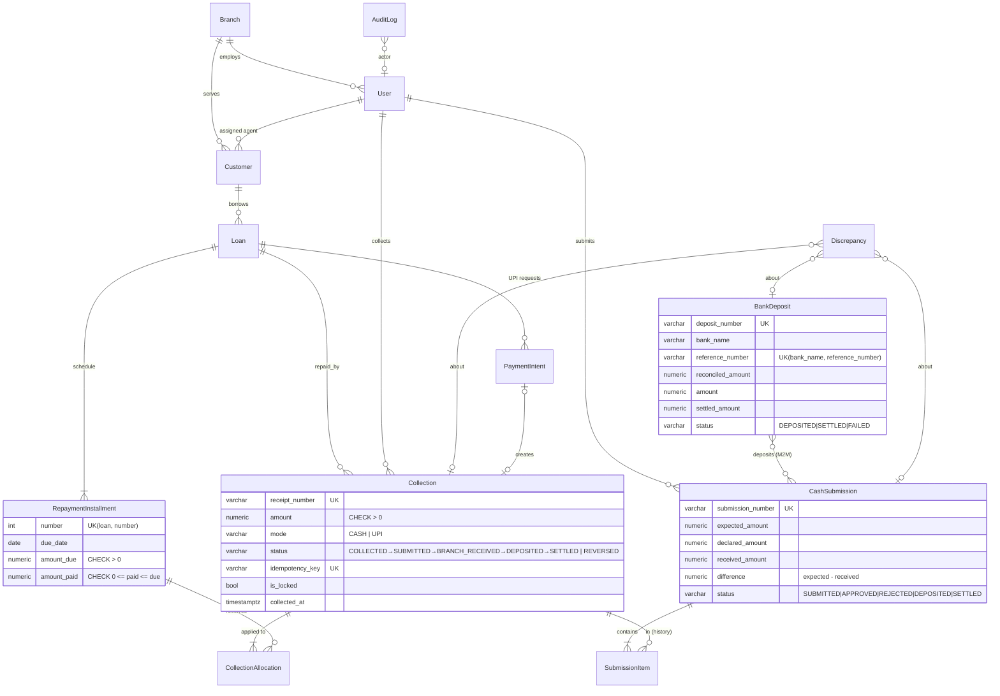

# Database Schema (PostgreSQL)

Every monetary column is `NUMERIC(14,2)` (Django `DecimalField` through `apps.core.fields.MoneyField`). Python arithmetic uses `Decimal` with `ROUND_HALF_UP` (`apps.core.money`); floats are rejected outright.

## Tables

| App | Table | Purpose / key constraints |
|---|---|---|
| core | `core_branch` | `code` unique |
| core | `core_auditlog` | Append-only (save and delete blocked in model). Indexed on `(entity_type, entity_id)` and `created_at` |
| accounts | `accounts_user` | Custom user: `role`, `branch` FK (required for agents and managers) |
| loans | `loans_customer` | `customer_code` unique; index `(branch, assigned_agent)` |
| loans | `loans_loan` | `loan_number` unique; checks: principal > 0, tenure > 0, rate ≥ 0 |
| loans | `loans_repaymentinstallment` | unique `(loan, number)`; check `0 ≤ amount_paid ≤ amount_due` (the DB itself prevents over-allocation) |
| cash | `cash_collection` | `receipt_number` and `idempotency_key` unique; amount > 0; indexes `(agent,status)`, `(branch,status)`, `(loan,collected_at)` |
| cash | `cash_collectionallocation` | Collection → installment split (partial payments) |
| cash | `cash_cashsubmission` | Agent → branch handover; expected > 0, declared/received ≥ 0 |
| cash | `cash_submissionitem` | Through table; unique `(submission, collection)`; keeps history across reject/resubmit |
| cash | `cash_discrepancy` | Type, expected/actual/difference, nullable FKs to submission, deposit or collection |
| deposits | `deposits_bankdeposit` | unique `(bank_name, reference_number)`; amount > 0 |
| deposits | `deposits_bankdeposit_submissions` | M2M; a failed deposit keeps its link for history |
| payments | `payments_paymentintent` | `gateway_ref` unique; one-to-one to the resulting collection |
| payments | `payments_webhookevent` | `event_id` unique, so webhook processing is idempotent |
| — | `token_blacklist_*` | SimpleJWT refresh-token rotation and blacklist |

## Design notes

- **Status columns + transition services** instead of an event-sourced ledger: simpler to reason about for a take-home, and the AuditLog provides the event history.
- **Outstanding is derived**, not stored: `SUM(amount_due - amount_paid)` over installments. Allocation rows make every rupee traceable from receipt to installment.
- **PROTECT** on every financial FK, so nothing financial can be cascade-deleted.
- **Concurrency**: collection recording locks the loan row (`SELECT … FOR UPDATE`); approvals, deposits and settlements lock their rows, so concurrent double actions serialise and the second one fails the state check.
- **Reference numbers** come from Postgres sequences (`cmrs_seq_<prefix>`), created lazily.
